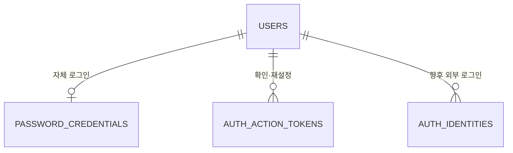

# 한달살림 인증 데이터 스키마 초안

> 상태: Implemented — V9·V13·V14 migration. 2026-10-28 사용자 확정: 원래 앱에서 메일 인증번호를 확인한 뒤 비밀번호 설정.
>
> 기준: `SERVICE_PLAN.md` 0.8, `docs/01-plan/schema.md`, `docs/02-design/auth-policy.md`
>
> 범위: 자체 로그인 자격 증명, 이메일 확인·비밀번호 재설정 링크, 서버 세션의 데이터 책임

## 1. 용어와 경계

| 용어 | 의미 |
|---|---|
| 사용자 | 공간·거래가 참조하는 안정적인 내부 `users.id` (UUID) |
| 자체 로그인 자격 증명 | 사용자의 이메일 로그인 주소와 비밀번호 해시. 외부 로그인 식별자와 별개 |
| 인증 작업 링크 | 이메일 확인 또는 비밀번호 재설정을 한 번 수행할 수 있는 만료형 토큰 |
| 서버 세션 | 로그인 상태를 서버에서 관리하는 인프라 데이터. 브라우저에는 세션 쿠키만 전달 |

`users.id`는 이메일 변경이나 향후 로그인 수단 추가와 관계없이 유지한다. 기존 `auth_identities`는 향후 외부 로그인 수단 전용이며, 이메일·비밀번호를 그 테이블의 `issuer`/`subject`에 억지로 넣지 않는다. 인증 데이터는 공간 소유 데이터가 아니므로 `space_id`를 갖지 않는다. 업무 API는 세션의 사용자 ID와 활성 공간 멤버십을 모두 확인한다.

## 2. 관계

`users`는 가입 때 만들되, 이메일 미확인 상태는 `users.status`에 새 값을 더하지 않고 자격 증명의 `email_verified_at IS NULL`로 판단하는 안이다. 확인 전에는 공간·거래 API 접근을 차단한다. `users.display_name NOT NULL`이므로 가입 때 표시 이름을 받는 안을 추천한다. 가입 시 표시 이름 입력을 구현 기본값으로 적용했다.

## 3. `password_credentials` (제안)

사용자 한 명에 자체 로그인 자격 증명은 최대 한 건이다. 비밀번호는 원문이나 복호화 가능한 값으로 보관하지 않는다.

| 필드 | PostgreSQL 타입 | 필수 | 제약/설명 |
|---|---|---:|---|
| `user_id` | `uuid` | Y | PK, FK → `users.id` |
| `email_address` | `varchar(254)` | Y | 메일 발송·표시용 원본 주소. 앞뒤 공백 제거 후 저장 |
| `email_lookup_key` | `varchar(254)` | Y | ASCII 이메일 전체 소문자화 비교 키. 점·+별칭 보존 |
| `password_hash` | `varchar(512)` | 조건부 | 신규 미확인 계정은 NULL. 이메일 확인 완료 시 적응형 해시 필수 |
| `email_verified_at` | `timestamptz` | N | 최초 이메일 소유 확인 시각 |
| `password_changed_at` | `timestamptz` | 조건부 | 해시와 함께 NULL 또는 함께 존재. 초기 설정 및 마지막 변경 시각 |
| `created_at` | `timestamptz` | Y | 생성 시각 |
| `updated_at` | `timestamptz` | Y | 변경 시각 |
| `version` | `bigint` | Y | 동시 변경 감지, 기본값 0 |

- UNIQUE: `email_lookup_key`. 조회·가입이 경쟁해도 데이터베이스 제약이 중복 계정 생성을 막는다.
- V13 CHECK: 이메일 확인 완료 계정은 해시·설정 시각이 모두 있어야 한다. 기존 확인 계정의 자격 증명과 기록은 그대로 유지한다. 구버전 미확인 계정의 해시는 보존하되 로그인에 사용하지 않고, 링크에서 설정한 새 비밀번호로 대체한다.
- 이메일 주소는 계정 식별·발송에만 사용하고 공개 프로필이나 공간 멤버 목록에 기본 노출하지 않는다.
- 2026-10-26 사용자 확인에 따라 앞뒤 공백을 제거하고 ASCII 이메일 전체를 소문자화한 비교 키를 사용한다. 국제화 이메일 원문은 초기 지원하지 않는다. Gmail식 점 제거·`+` 별칭 제거를 모든 주소에 적용하지 않는다.
- 이메일 변경, 여러 이메일 추가, 탈퇴 후 주소 재사용은 이 초안의 범위 밖이며 별도 정책이 필요하다.

## 4. `auth_action_tokens`

V14 이후에는 인증번호 확인에 성공한 뒤 비밀번호 설정·재설정에만 쓰는 10분짜리 일회용 권한을 저장한다. 원문은 메일이나 URL이 아닌 API 응답으로 원래 화면에 전달하고 메모리에서만 사용한다. 기존 메일 링크의 행은 원래 만료시간까지 호환한다. 아래 링크 관련 설명의 24시간·30분은 구버전 행에 한정하며 신규 발급에는 적용하지 않는다.

링크 원문은 난수로 발급해 사용자에게만 전달하고 서버에는 검증용 해시만 저장한다. 비밀번호 해시와 달리 충분히 긴 무작위 토큰의 단방향 지문으로 조회할 수 있다.

| 필드 | PostgreSQL 타입 | 필수 | 제약/설명 |
|---|---|---:|---|
| `id` | `uuid` | Y | PK, 서버 생성 |
| `user_id` | `uuid` | Y | FK → `users.id` |
| `purpose` | `varchar(20)` | Y | `EMAIL_VERIFY`, `PASSWORD_RESET`만 허용 |
| `token_hash` | `bytea` | Y | 원문을 저장하지 않는 검증용 해시 |
| `expires_at` | `timestamptz` | Y | 사용 가능 종료 시각 |
| `consumed_at` | `timestamptz` | N | 성공적으로 사용한 시각 |
| `revoked_at` | `timestamptz` | N | 재발급 등으로 폐기한 시각 |
| `created_at` | `timestamptz` | Y | 발급 시각 |

- UNIQUE: `token_hash`. INDEX: `(user_id, purpose)`.
- 제안 제약: 사용자·목적별 미사용·미폐기 토큰은 최대 한 건. 만료된 이전 토큰도 재발급 트랜잭션에서 폐기해 부분 UNIQUE 인덱스와 충돌하지 않게 한다.
- 사용 시 `purpose`, 만료, 사용·폐기 여부를 확인하고 소비 처리를 한 트랜잭션에서 수행한다. 두 요청이 동시에 같은 링크를 사용해도 성공은 한 번뿐이어야 한다.
- 링크 재발급은 앞선 같은 목적의 링크를 폐기한다. 비밀번호 재설정은 확인된 이메일에만 발급하고, 계정 존재 여부를 응답에서 드러내지 않는다.
- 구현한 인증 링크 만료값은 확인 24시간, 재설정 30분이다. 값이 바뀌어도 테이블 구조는 유지된다.
- 사용·만료·폐기된 행은 악용 조사와 개인정보 최소 보존의 균형을 고려해 7일이 지난 뒤 시간 단위 작업으로 정리한다.

## 4.1 `email_auth_codes` (V14)

- `id` UUID는 요청 식별자이며 단독으로 인증·로그인 권한을 주지 않는다. `user_id` FK, `purpose`(EMAIL_VERIFY/PASSWORD_RESET), `code_hash`, `failed_attempts`(0~5), `expires_at`, `consumed_at`, `revoked_at`, `created_at`을 저장한다.
- 숫자 8자리 원문은 암호학적 난수로 만들며 앞자리 0을 유지한다. 짧은 번호를 단순 SHA-256으로 저장하지 않고 요청 ID·목적을 포함한 PBKDF2 적응형 해시로 저장한다.
- 코드 행과 자격 증명을 잠가 단일 사용·실패 횟수·재발급을 직렬화한다. 오류로 응답해도 잘못된 번호 시도 횟수는 커밋한다. 5회 실패와 10분 만료 후에는 올바른 번호도 거부한다.
- 사용자·목적별 활성 번호는 한 건이다. 재발급 시 기존 번호와 기존 설정 권한을 폐기한다. SMTP 실패는 트랜잭션을 롤백해 이전 번호를 보존한다. 존재하지 않는 계정 등 부적격 요청에는 같은 응답 모양의 무작위 요청 ID만 반환한다.
- 번호 확인은 로그인 세션을 만들거나 계정을 활성화하지 않는다. 이후 비밀번호 설정과 이메일 확인 시각 기록·권한 소비를 원자적으로 처리한다.
- 코드 행도 사용·폐기·만료 후 7일 보존 정리 정책을 적용한다. 기존 로컬 admin 연결 시 자격 증명·작업 토큰과 함께 코드의 사용자 참조도 이전한다.

## 5. 세션과 생명주기

세션은 Spring Session JDBC가 관리하는 인프라 테이블(`SPRING_SESSION`, `SPRING_SESSION_ATTRIBUTES`)에 둔다. 해당 버전의 공식 DDL을 검토해 Flyway로 관리하고, 업무 ERD의 자체 인증 토큰 테이블과 섞지 않는다. 세션 ID 원문과 비밀번호는 애플리케이션 로그에 기록하지 않는다.

- 가입: 이름·이메일만 받아 `users`와 비밀번호 없는 `password_credentials`를 함께 생성한다. 재가입도 비밀번호를 정할 수 없다. 이메일 발송 실패·재시도 처리는 계정 중복과 링크 중복을 만들지 않아야 한다.
- 이메일 확인: 원래 화면에서 번호를 확인한 뒤 비밀번호·확인을 입력한다. 설정 권한·비밀번호를 서버가 검증한 뒤 해시·설정 시각·`email_verified_at`·version과 권한 소비를 한 트랜잭션으로 확정한다. 완료 전 업무 API는 거부하며 잘못된 비밀번호로 설정 권한을 소모하지 않는다.
- 로그인: 확인된 활성 사용자에게만 새 서버 세션을 부여한다. 로그인 성공 시 세션 ID를 갱신한다.
- 비밀번호 재설정: 링크 소비, 해시 변경, 기존 세션 무효화를 일관되게 처리한다. 기존 비밀번호로는 다시 로그인할 수 없다.
- 로그아웃: 해당 서버 세션을 무효화한다. 쿠키 만료만으로 처리하지 않는다.
- 추천 세션 정책의 미사용 7일과 로그인 후 절대 최대 30일은 별개다. JDBC 세션의 일반 만료 설정만으로 절대 만료가 충족된다고 가정하지 않고 생성 시각 기준 검사를 설계·검증한다.
- 계정 탈퇴 시 자격 증명·인증 링크·세션 정리와 공동 공간 데이터의 보존·소유권 처리는 함께 정책을 정한다. 도메인 금융 기록에 무조건적인 연쇄 삭제를 설정하지 않는다.

## 6. 구현 전 검증 항목

- 동일 이메일 동시 가입은 사용자·자격 증명 쌍 하나만 만들고, 실패한 가입으로 고아 `users` 행을 남기지 않는다.
- 이메일 비교 규칙의 대소문자·국제화·별칭 사례를 고정된 테스트 데이터로 검증한다.
- 미확인 사용자는 세션이 있더라도 공간 생성과 거래 API를 사용할 수 없다.
- 확인·재설정 링크의 위조·만료·재사용·동시 사용·재발급 후 이전 링크 사용은 실패한다.
- 비밀번호 재설정 뒤 기존 세션과 이전 비밀번호가 모두 거부된다.
- 서버 재시작 후 유효 세션은 유지되고, 미사용 기간과 절대 만료 중 먼저 도달한 시점에 거부된다.
- 다른 사용자의 `user_id`, `space_id`를 요청에 넣어도 인증·멤버십 우회가 불가능하다.
- 로그와 오류 응답에 비밀번호, 토큰 원문, 전체 이메일, 세션 ID가 나오지 않는다.

## 7. 승인 대기 결정

| ID | 결정 | 추천안 | 이유 |
|---|---|---|---|
| AUTH-DATA-01 | 표시 이름 입력 시점 | 가입 때 이메일·비밀번호와 함께 받기 | 기존 `users.display_name NOT NULL` 유지 |
| AUTH-DATA-02 | 이메일 중복 판정 | 원본 보존, ASCII 이메일 전체 소문자화 비교, 점·+별칭 보존 (사용자 확인) | 계정 충돌과 로그인 혼란 방지 |
| AUTH-DATA-03 | 사용한 인증 링크 보존 기간 | 사용·폐기·만료 후 7일 보존, 시간 단위 정리 (사용자 확인) | 감사와 개인정보 최소 보존 균형 |

`docs/02-design/auth-policy.md`의 AUTH-02~06도 기능별 결정 대기다. 전체 인증 정책의 일괄 확정은 요구하지 않는다. 자격 증명·확인·재설정·세션 중 실제로 구현하는 부분에 필요한 결정만 먼저 확정한다. 다른 기능과 프로젝트 초기화는 이 초안 때문에 중단하지 않는다.

## 8. 근거

- [OWASP 이메일 검증 및 확인](https://cheatsheetseries.owasp.org/cheatsheets/Email_Validation_and_Verification_Cheat_Sheet.html)
- [OWASP 비밀번호 재설정](https://cheatsheetseries.owasp.org/cheatsheets/Forgot_Password_Cheat_Sheet.html)
- [Spring Security 비밀번호 저장](https://docs.spring.io/spring-security/reference/features/authentication/password-storage.html)
- [Spring Session JDBC](https://docs.spring.io/spring-session/reference/configuration/jdbc.html)

## 9. 구현 보완

- `auth_rate_limits`: 이메일·IP의 SHA-256 기반 버킷 키, 15분 시작 시각, 요청 횟수. 원문은 보관하지 않으며 1일 지난 행은 삭제한다.
- `password_credentials.version`을 세션에 함께 보관하고 요청마다 활성 사용자·이메일 확인·버전 일치를 검증한다. 비밀번호 변경 시 버전 증가로 기존 세션을 거부한다.
- 세션 속성에는 내부 사용자 ID, 자격 증명 버전과 최초 로그인 시각만 보관한다. 비밀번호·메일 토큰은 보관하지 않는다.
- 등록·링크 재발급·소비는 이메일별 PostgreSQL 트랜잭션 advisory lock과 자격 증명·토큰 행 잠금으로 직렬화한다. 동일 링크의 동시 소비는 한 번만 성공한다.
- 기존 로컬 기록 연결은 지정 이메일 확인 후 자격 증명·인증 링크의 사용자 참조만 admin으로 바꾼다. 새로 가입했던 임시 users 행은 공간이 없는 경우에만 정리한다. 기존 금융 행은 변경하지 않는다.
