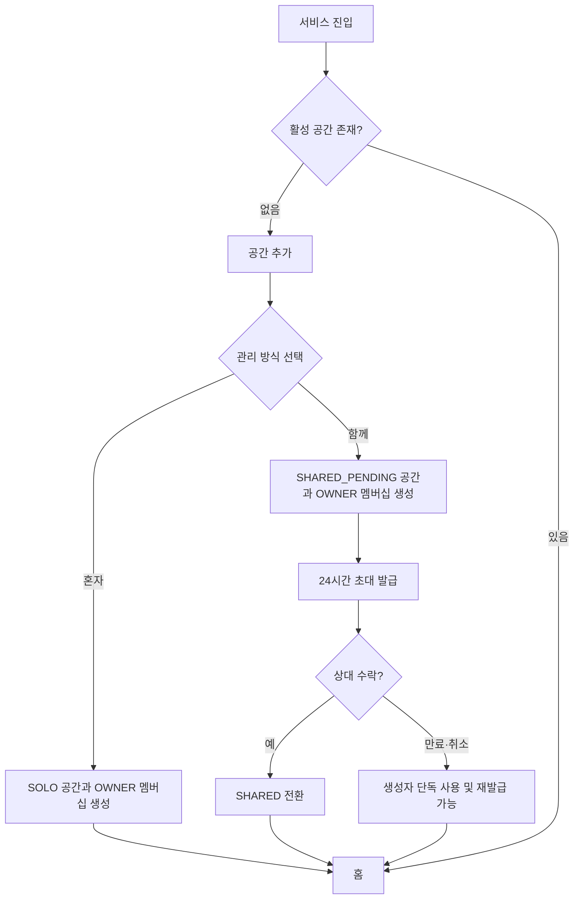
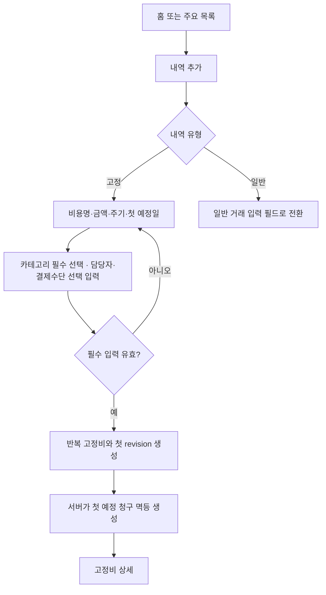
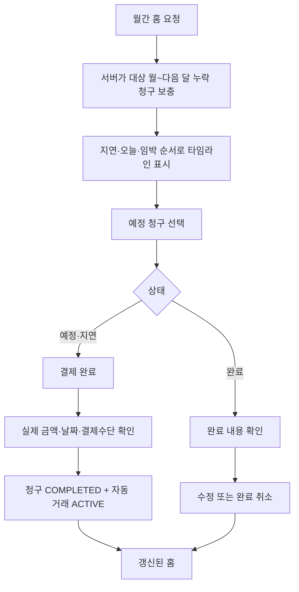
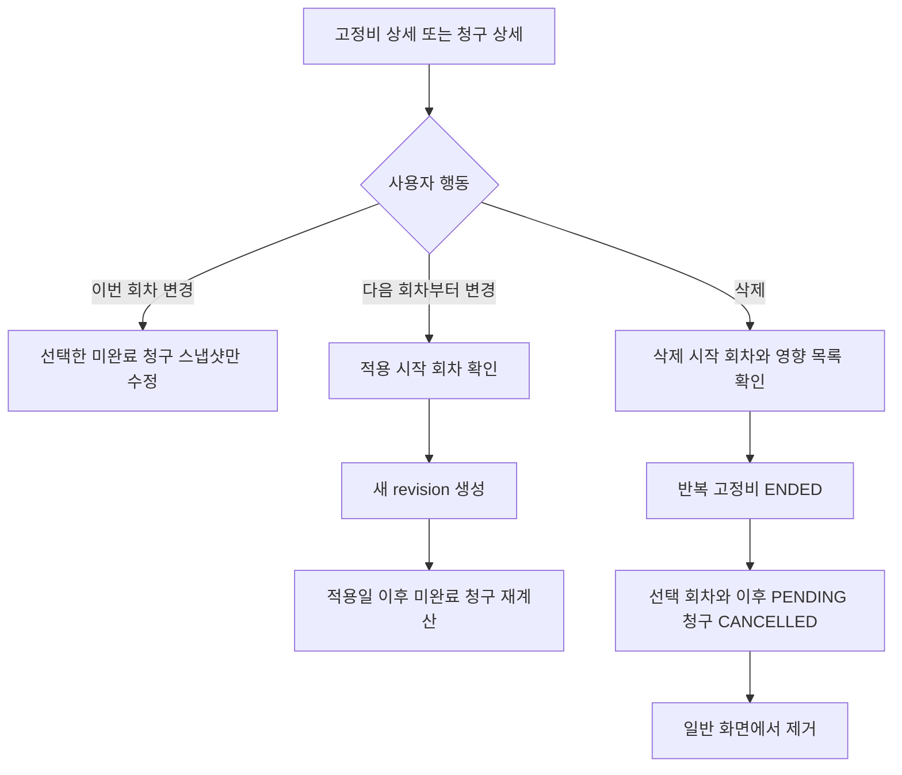
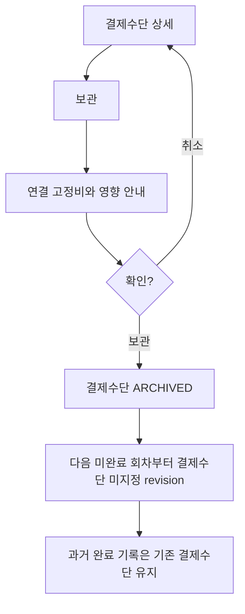
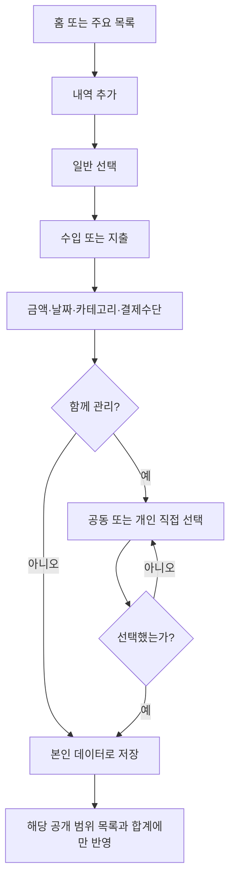
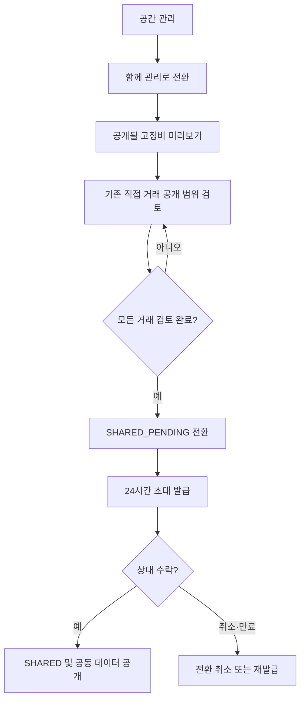

# 한달살림 MVP 사용자 흐름

> 상태: Draft — 사용자 승인 전 구현 기준으로 사용하지 않음
>
> 로그인·인증 완료 후의 제품 흐름만 다룬다.

## 1. 첫 공간 생성

관리 방식에는 기본 선택값을 두지 않는다.

## 2. 첫 고정비 등록

2026-10-14 변경 흐름은 **지출 탭 → 우측 상단 추가 → 대분류 선택 → 소속 중분류 선택 → 선택 메모와 금액·일정·결제수단 입력 → 저장 → 상세**다. 메모 없이도 등록하며 중분류명을 표시명으로 사용한다. 필요한 분류는 설정의 분류 설정에서 추가한다. 대분류·중분류·금액은 필수이고 반복주기·반복 결제일·첫 결제일이 모두 정해졌을 때만 예정 청구를 생성한다. 아래 초기 Draft의 필수 지출명·단일 카테고리·통합 등록 진입보다 이 내용과 `SERVICE_PLAN.md` 1.4를 우선한다.

2026-10-13 확정 흐름: 고정비 탭(`/fixed-costs`)은 목록만 표시한다. 우측 상단 `+` → 추가(`/entries/new`) → 저장 후 상세(`/fixed-costs/[id]`)로 이동한다. 목록 항목도 같은 상세로 이동한다. 모든 정보는 상세의 `정보 수정`에서 편집하고 저장 후 상세로 돌아온다. 아래 초기 Draft 흐름보다 이 내용과 `SERVICE_PLAN.md`를 우선한다. 모든 화면의 구성은 [공통 UI/UX 가이드](ui-ux-guide.md)를 따른다.

카테고리는 등록·수정 시 필수다. 담당자와 결제수단은 선택 입력이며, 입력하지 않은 값은 `-`로 보여주고 고정비 상세에서 나중에 보완한다. 기존 카테고리 미지정 내역은 유지하되 수정 저장 시 선택해야 한다. 결제 완료 시에는 실제 결제수단을 필수로 선택한다.

## 3. 월간 홈과 결제 완료

2026-10-14 홈 구성은 대분류별 고정비 차트 → 중분류별 월간 변화 → 결제수단별 금액이다. 결제 일정 확인과 아래 완료 흐름은 유지한다. 월간 변화에서 미확정·기록 없음은 0원으로 처리하지 않으며 집계 월과 비교 금액의 정책은 구현 전에 확정한다.

저장 버튼을 연속으로 누르거나 네트워크가 재시도되어도 같은 자동 거래 한 건만 존재해야 한다.

## 4. 고정비 변경과 삭제

- 완료된 과거 청구와 거래는 어떤 경로에서도 변경하지 않는다.
- MVP에는 한 회차만 삭제하는 흐름이 없다.

## 5. 결제수단 보관

대체 결제수단을 강제로 등록시키지 않는다. 결제 완료 시점에는 실제 결제수단을 필수로 선택한다.

## 6. 직접 거래 등록

상대 사용자의 개인 거래는 존재 여부, 건수와 금액까지 노출하지 않는다.

## 7. 혼자 관리에서 함께 관리로 전환

초대 수락 전에는 기존 거래를 상대에게 공개하지 않는다.

## 8. 실패와 복구

| 실패            | 사용자 경험                                   | 데이터 규칙                      |
| --------------- | --------------------------------------------- | -------------------------------- |
| 목록 조회 실패  | 기존 화면을 지우지 않고 오류와 다시 시도 제공 | 조회가 쓰기를 중복 생성하지 않음 |
| 완료 응답 유실  | 다시 시도 가능                                | 같은 청구·거래 결과 반환         |
| 동시 수정 충돌  | 최신 값 안내 후 다시 확인                     | `version`으로 덮어쓰기 방지      |
| 초대 만료       | 만료 안내와 재발급 진입                       | 기존 token 재사용 차단           |
| 권한 상실       | 안전한 공통 오류와 홈 이탈                    | 데이터 존재 여부 추가 노출 금지  |
| 결제수단 미지정 | 경고 배지와 선택 행동                         | 완료 전 실제 결제수단 필수       |
